# Lab 07: Access Review and Audit

  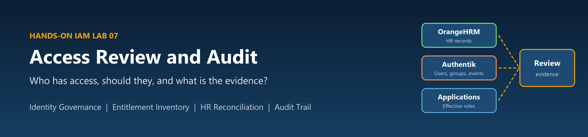

  <strong>Professional Lab Documentation | Identity & Access Management / Identity Governance</strong>

  
  
  
  
  

---

## Table of Contents

1. [Project Overview](#project-overview)
2. [Objectives](#objectives)
3. [Scenario / Business Context](#scenario-business-context)
4. [Technologies & Tools](#technologies-tools)
5. [Architecture / Workflow](#architecture-workflow)
6. [Implementation / Steps Performed](#implementation-steps)
7. [Key Findings / Results](#key-findings-results)
8. [Skills Demonstrated](#skills-demonstrated)
9. [Screenshots & Evidence](#screenshots-evidence)
10. [Real-World Relevance](#real-world-relevance)
11. [Summary](#summary)
12. [Disclaimer](#disclaimer)

---

## :pushpin: Project Overview

This lab is a **User Access Review (UAR)** across a small identity environment: **Authentik** as the identity provider, **WordPress** and **Grafana** as the applications it controls, and **OrangeHRM** as the HR source of truth.

Earlier labs in the series granted access. This one questions it. The review answers three questions with evidence rather than opinion: *who has access to what*, *should they still have it*, and *what does the audit trail say about how they got it*. The guide describes the deliverable as a list of grants, a decision on each with a written reason, and an audit trail backing those decisions up.

**Main objective:** produce an access review that someone else could verify without the reviewer present: an entitlement inventory at the grant level, usage and HR evidence for every row, provenance for key findings, and optional data exports.

> **Evidence scope.** This documentation is based on the training guide *Hands-On IAM Labs – Lab 7: Access Review and Audit* by **Andrew, All Things Identity** (guide version V8). All screenshots are the guide author's example screenshots, captured on Authentik 2026.8.5, Grafana 11.6.0, WordPress with miniOrange SAML and OrangeHRM 5.8.1 in November 2026, and are attributed to All Things Identity. They show what the guide expects a reviewer to see; they are **not** evidence that the portfolio owner personally completed the lab. Results below are described as **source-demonstrated** or **expected**, and names, counts and values taken from the screenshots are **examples from the guide's environment**. No completed inventory, certification decisions or exports are included.

### Lab Environment (from the source guide)

| Component | Details |
|---|---|
| Identity provider | Authentik (screens captured on 2026.8.5) |
| Applications under review | WordPress (SAML, miniOrange plugin) and Grafana 11.6.0 (OAuth2/OpenID) |
| HR source of truth | OrangeHRM 5.8.1 |
| Transport | Plain HTTP by design (lab only; production uses HTTPS) |
| Authentik address | `YOUR_AUTHENTIK_URL` (the `http://address:port` part of the lab link, no trailing slash) |
| Access required | Authentik admin and OrangeHRM admin |

**Prerequisites listed in the guide:** Lab 1 (accounts provisioned from OrangeHRM, including at least one terminated leaver), Lab 3 (WordPress federated to Authentik), Lab 4 (groups gate application access), Lab 5 (a second application with its own group-to-role mapping) and **Lab 6, which must be completed before this lab**. Lab 6 reactivates the leaver that Lab 1 disabled, and that reactivated account is the finding Section 03 is built around. If Lab 7 is run first, Section 03 has nothing to find, because Lab 1 did its job correctly.

---

## :dart: Objectives

The guide's stated learning objectives are to:

- Build an entitlement inventory: the complete list of who currently has what
- Certify each grant with a decision and a stated reason
- Identify dormant accounts from login history rather than from assumption
- Reconcile identity data against the HR source of truth and find the orphan
- Read the audit trail to establish when a grant was made and by whom
- Spot privileged activity that deserves a second look
- Produce an evidence package someone else could verify without the reviewer

---

## :office: Scenario / Business Context

The guide does not describe a specific organization. Its framing is that access is easy to give, invisible once given, and rarely noticed when it is wrong until someone comes looking. Access reviews are the control that goes looking, and the guide notes they are a frequent job requirement that tutorials rarely cover, because they need an environment with a history of accounts that were created, changed, used and abandoned. The earlier labs built exactly that history.

The guide separates a real review from a rubber stamp by **evidence**: "I looked and it seemed fine" is not a review.

### Review vocabulary (from the guide)

| Term | Meaning |
|---|---|
| Review / campaign | The exercise as a whole |
| Certification | A named person deciding that a specific grant should continue |
| Attestation | That person putting their name to the decision |
| Recertification | Doing it again in the next cycle |
| UAR | User Access Review, for example "quarterly UARs" |

The guide adds that the first question a good auditor asks is not whether a review was run, but **who certified, and what they were shown**.

---

## :hammer_and_wrench: Technologies & Tools

| Technology / Tool | Purpose in this lab |
|---|---|
| **Authentik** Directory | Source of the user population (active and inactive accounts), group membership and the Last login column |
| **Authentik** Applications and bindings | Shows which groups gate each application through *Policy / Group / User Bindings* |
| **Authentik** Events > Logs | Audit trail: login history, object changes, impersonation, secret views and password changes, searched with the event query language |
| **Authentik** System > Settings | Event retention setting, which limits how far back the evidence goes |
| **Authentik API v3** | Optional read-only JSON exports of users, groups, applications, events and bindings |
| **OrangeHRM** PIM | HR source of truth for current and past employees |
| **Grafana** | Second application; its user list shows each person's effective role |
| **WordPress** with miniOrange SAML | First application; its Users page shows each person's role |

### Event log filters used in the guide

| Purpose | Filter |
|---|---|
| All login events | `action = "login"` |
| One person's logins | `action = "login" and user.username = "their-username"` |
| Object creation and changes | `action in ("model_created", "model_updated")` |
| Impersonation | `action in ("impersonation_started", "impersonation_ended")` |
| Token or certificate views | `action = "secret_view"` |
| Password changes | `action = "password_set"` |

The guide stresses that a filter does nothing until **Enter** is pressed. Figure 7.32 also narrows the creation events to groups with `context.model.model_name = "group"`.

---

## :building_construction: Architecture / Workflow

Both diagrams below are written in Mermaid inside this README, so GitHub draws them directly. To change a label, box or arrow, edit the text in the `mermaid` code block.

### Architecture

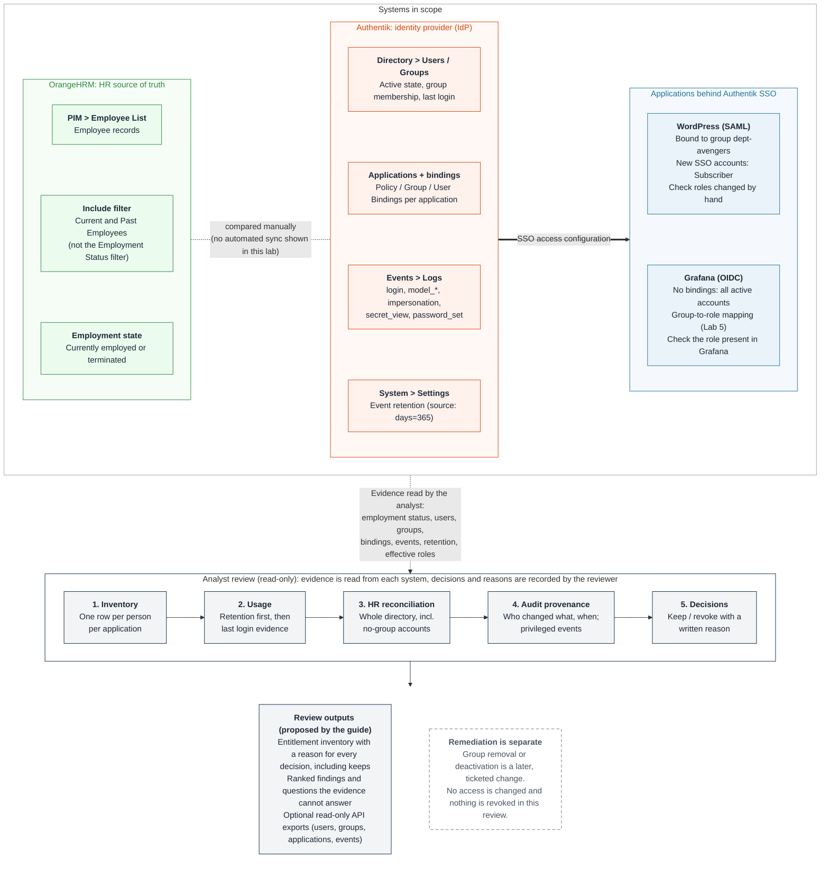

Image version of this diagram: [`assets/architecture.png`](assets/architecture.png)

The diagram separates three kinds of relationship:

- **Access configuration (thick arrow):** Authentik provides single sign-on to WordPress and Grafana. WordPress is gated by a group binding; Grafana has no binding, so every active account can sign in.
- **Evidence collection (dotted arrow):** the analyst reads employment status from OrangeHRM, users, groups, bindings, events and retention from Authentik, and effective roles from each application.
- **HR reconciliation (dotted line, no arrowhead):** the analyst compares the directory against HR by hand. The guide does not show an automated HR synchronization in this lab.

Remediation sits outside the review. The guide explains that a wrong grant is usually fixed by removing the person from a group, but this documentation does not change access, disable accounts or revoke anything.

### Review workflow

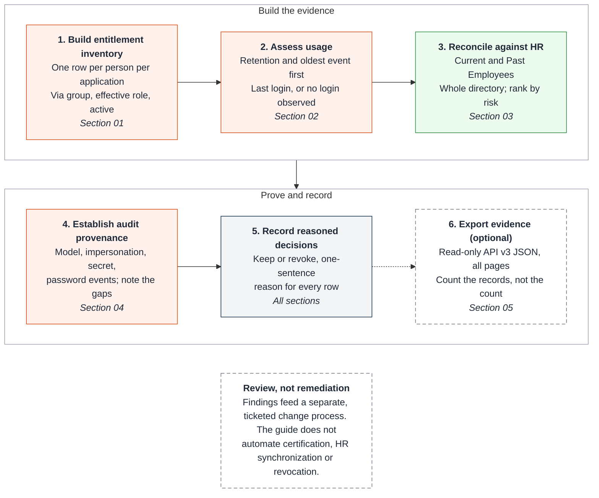

Image version of this diagram: [`assets/workflow.png`](assets/workflow.png)

Each stage adds columns or evidence to the same inventory. Sections 01 to 04 build the review; Section 05 exports the underlying data so the review can be repeated and checked.

---

## :gear: Implementation / Steps Performed

The steps below follow the five sections of the source guide. Screenshots are the guide's example screens. Key screens are shown inline; supporting screens are in expandable sections under each part.

### Section 01: Build the entitlement inventory

**Goal:** produce the complete current-state list of grants across both applications.

**Step A: Enumerate the population.** In the Authentik admin interface, **Directory > Users** gives the total account count, split into active and inactive accounts. Inactive accounts show *No* under Active and still count. **Directory > Groups** gives each group with its member count, and **Applications > Applications** lists the applications under review.

<strong>Supporting screenshots (4):</strong> users, inactive accounts, groups and applications

  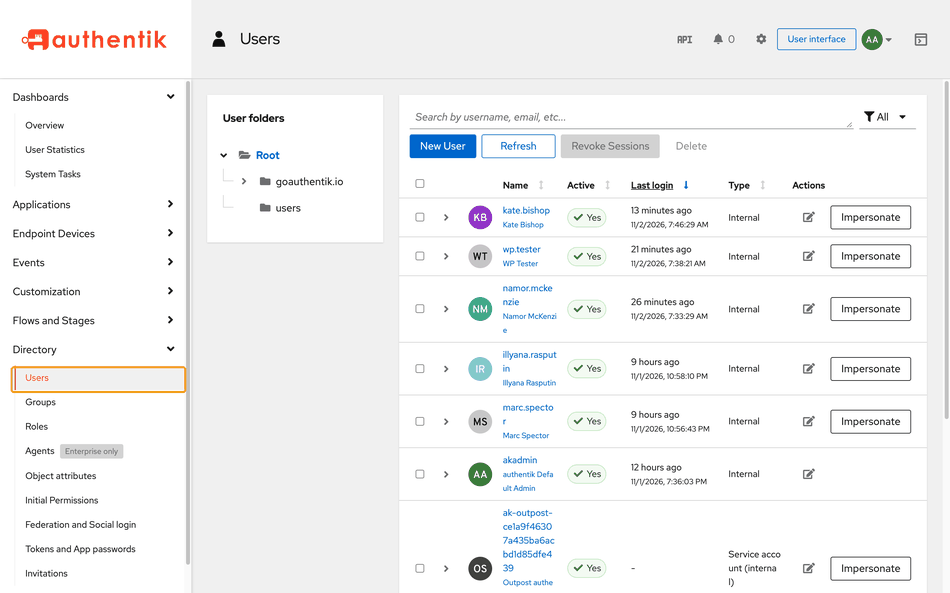 Users list with usernames, active state and last login" width="85%" />
   <em>Directory > Users holds every account, active or not, so this is where your population comes from. (Source: p. 4, Figure 7.2)</em>

  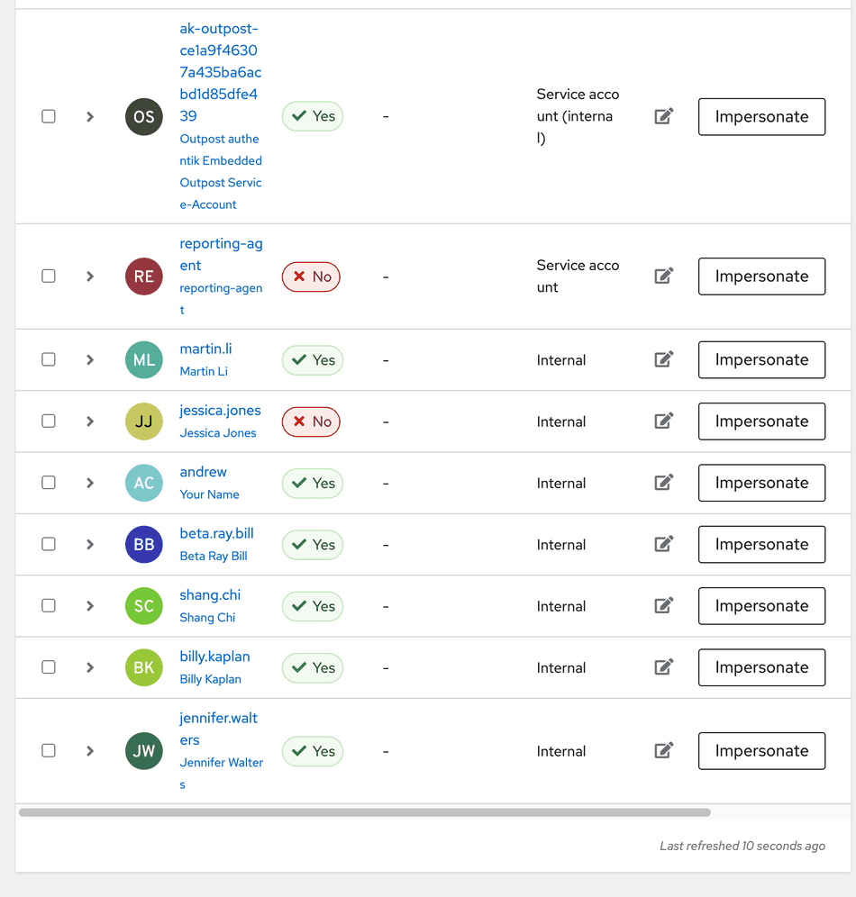
   <em>The bottom of the Users list. Inactive accounts show No under Active, and they still count. (Source: p. 5, Figure 7.3)</em>

  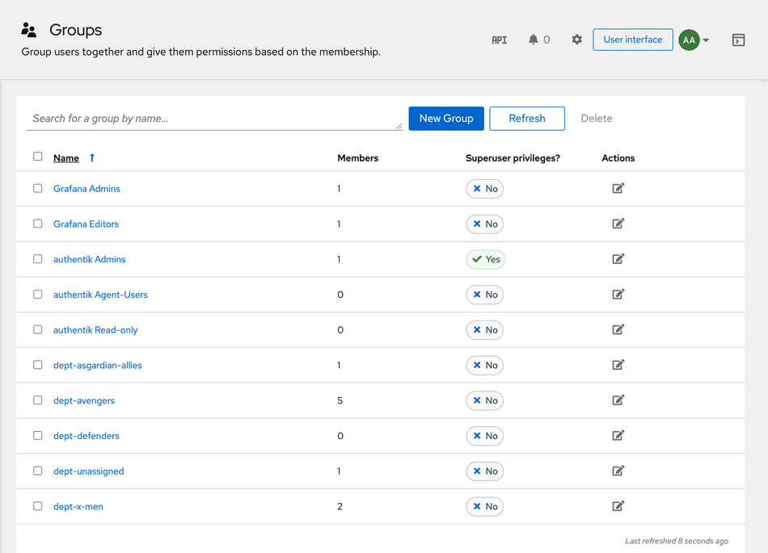 Groups with member counts for each group" width="85%" />
   <em>Each group with its member count. These numbers become rows in your inventory. (Source: p. 6, Figure 7.5)</em>

  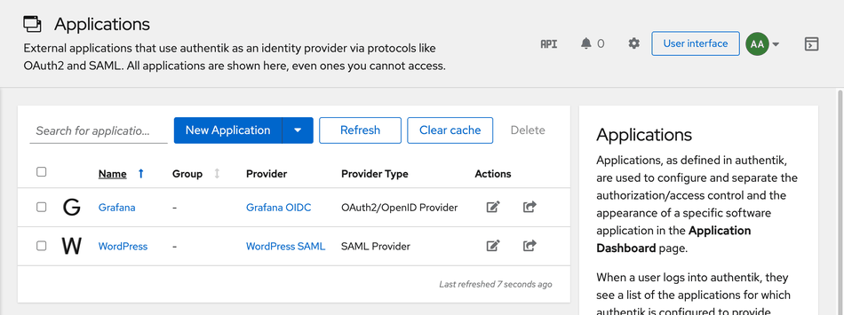
   <em>Two applications, Grafana and WordPress. Both get reviewed, one row per person each. (Source: p. 7, Figure 7.7)</em>

**Step B: Map groups to applications.** Each application's **Policy / Group / User Bindings** tab shows which groups are bound:

- **Grafana has no bindings.** The guide stresses that an unbound application is not locked down: every active account in the directory can sign in. It is recorded as **"all active accounts"**, which means one Grafana row for every active user.
- **WordPress is bound to `dept-avengers`.** Only members of that group get in, and they are the WordPress rows.

  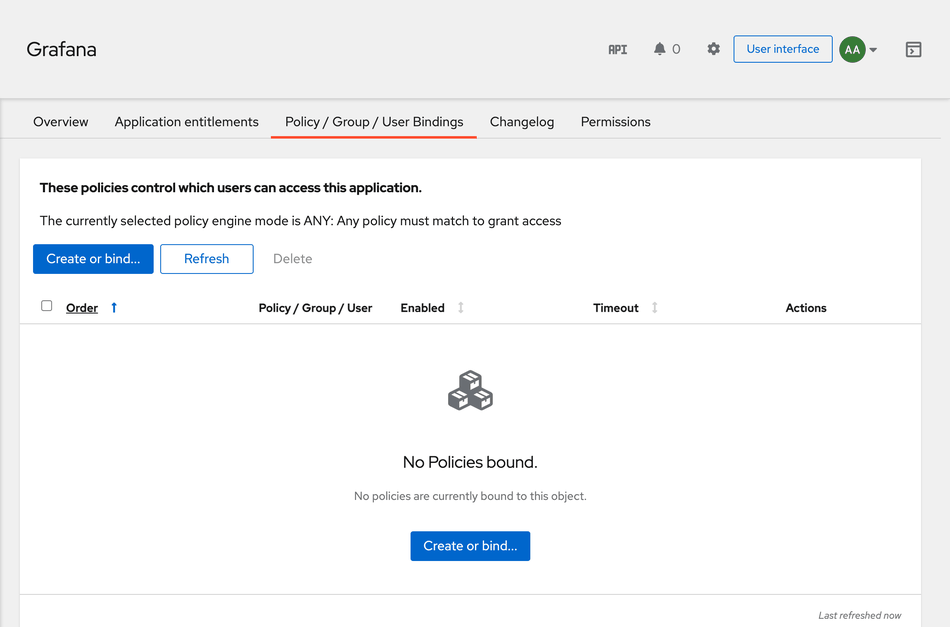
   <em>Grafana has no bindings, so every active account can sign in. Record it as all active accounts. (Source: p. 9, Figure 7.9)</em>

  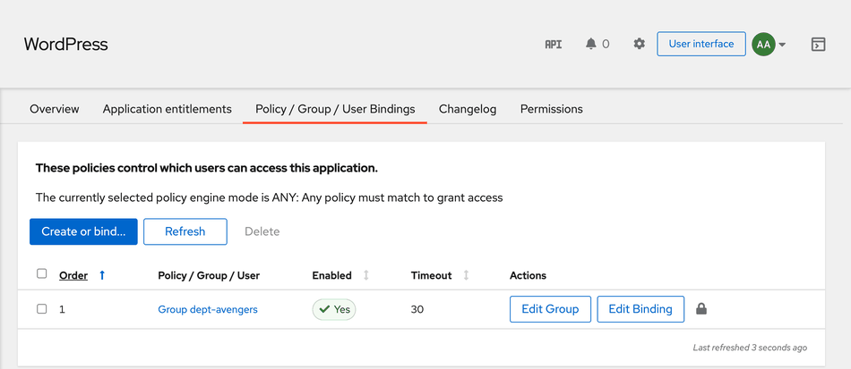
   <em>WordPress is bound to one group, dept-avengers. Only its members get in, and that is who your WordPress rows are. (Source: p. 9, Figure 7.10)</em>

The **effective role** is recorded per application:

- **Grafana:** the *Role attribute path* from Lab 5 maps Grafana Admins to Admin and checks Grafana Editors next. The field is narrow and clips the end of the expression in the screenshot, so the guide tells the reviewer to read the full value, including the fallback role, on their own screen. This documentation does not reconstruct the clipped part. The reviewer then checks the role each person actually holds in Grafana's user list, which is the Effective role column.
- **WordPress:** the free SAML plugin has no per-group role mapping. Every new SSO account gets one default role, **Subscriber**, and the plugin sets it only when the account is created. The reviewer looks in WordPress **Users** for anyone with a different role, because a role changed by hand is a grant no group explains. The guide records the missing per-group mapping as a finding in its own right: there is no group-based role differentiation in this plugin configuration, so every new SSO user lands in the same role. WordPress's own roles still apply, which is why roles changed by hand need inspection.

  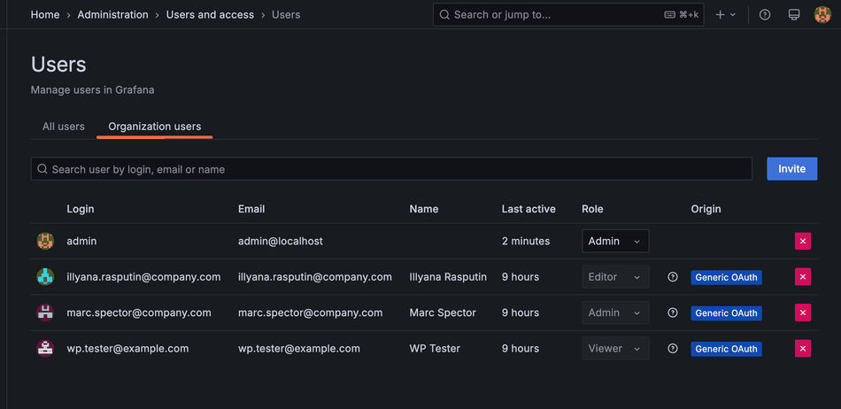
   <em>Grafana's user list shows the role each person actually landed in. That is your Effective role column. (Source: p. 10, Figure 7.12)</em>

  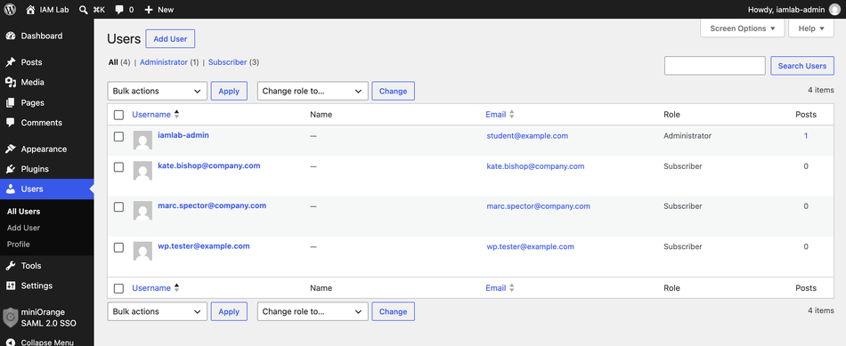
   <em>WordPress Users with the Role column. Here everyone except the local admin is Subscriber. Look for anyone else, because a hand-edited role is a grant no group explains. (Source: p. 11, Figure 7.14)</em>

<strong>Supporting screenshots (2):</strong> Grafana role attribute path (clipped) and WordPress default role

  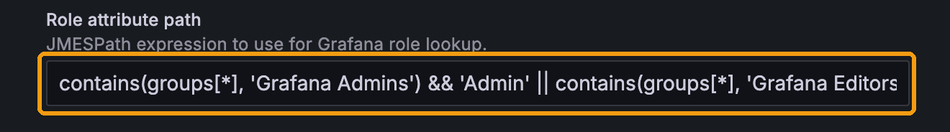
   <em>Grafana's Role attribute path from Lab 5. Grafana Admins map to Admin and Grafana Editors are checked next. The field is narrow and cuts off the end, so read the full value on your own screen. (Source: p. 10, Figure 7.11)</em>

  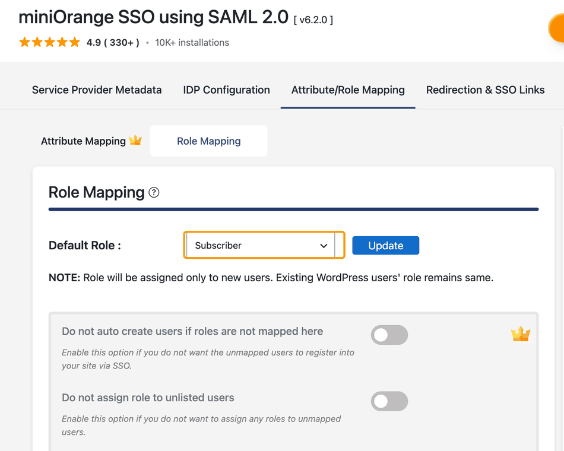
   <em>Every new SSO account in WordPress gets one default role, Subscriber. There is no per-group mapping, and that is a finding. (Source: p. 11, Figure 7.13)</em>

**Step C: Write the inventory down.** The inventory has **one row per person per application**, not one row per person. Someone with access to both applications holds two grants, and each is certified separately.

| Column | What goes in it |
|---|---|
| User | Username and email from Authentik |
| Application | WordPress or Grafana |
| Via group | The group that produces this access |
| Effective role | What the person can do once inside, for example Editor, Viewer or Admin |
| Account active | Yes or no, from Directory > Users |
| Last login | Filled in during Section 02 |
| HR status | Filled in during Section 03 |
| Decision | Keep or revoke |
| Reason | One sentence. Mandatory, including for keeps |

**Why "Via group" is a column:** it shows where to act. The guide explains that a wrong grant is almost never fixed at the application; it is fixed by removing the person from a group. A review that only records "user X has access to Y" produces findings nobody can act on.

**Checkpoint 1 (from the guide):** the row count should equal the number of active accounts (one Grafana row each) plus the WordPress group members. If it equals the user count instead, the inventory was built one row per person.

### Section 02: Find the dormant accounts

**Goal:** use login history to separate accounts in use from accounts that merely exist.

**Step A: Confirm there is history to work with.** In **Events > Logs**, the filter `action = "login"` lists login events. Sorting the *Creation Date* column oldest first shows how far back the records go. **System > Settings > Event retention** then shows the configured window.

The guide treats retention as the first question, not a detail. In the source example the setting reads `days=365`, the default. That is a **configured limit, not proof of a year of history**: the lab is newer than a year, so the real limit is the day it was built, and the oldest event is what matters. A "no logins found" result only means none were found in the available window.

  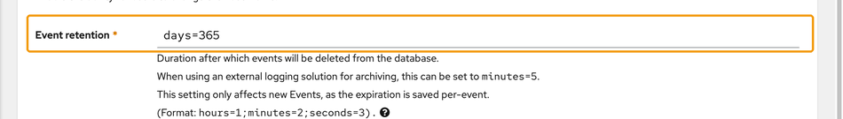 Settings showing Event retention days=365" width="85%" />
   <em>Event retention reads days=365, the default. Older events are deleted, so "no login" only means "none in this window". (Source: p. 18, Figure 7.20)</em>

<strong>Supporting screenshot:</strong> login events, newest first

  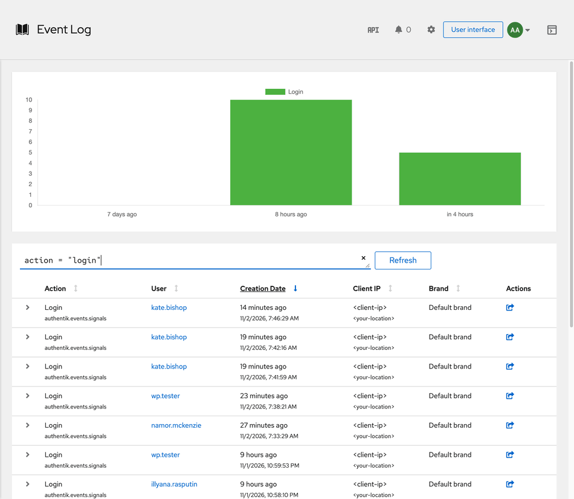
   <em>Login events, newest first, which is how the list opens. Click the Creation Date header to flip the order. The oldest row tells you how far back your evidence goes. (Source: p. 17, Figure 7.18)</em>

**Step B: Fill in the Last login column.** For each person in the inventory, the filter `action = "login" and user.username = "their-username"` lists their logins, and the most recent one is recorded. If there is none, the value is recorded as **never**, meaning *no login observed in the available evidence window*. The **Last login** column in Directory > Users is a quick cross-check, but the login event remains the evidence, because it shows when and from where.

  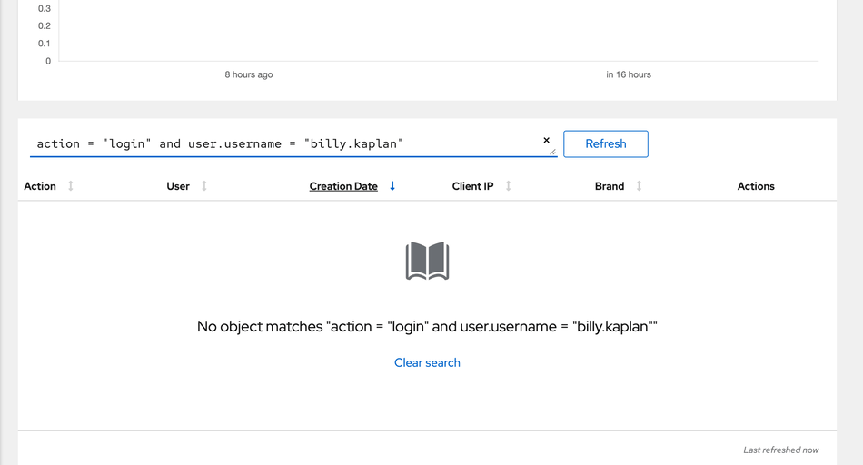
   <em>No login events at all for this account. That is a dormant candidate, until you check when it was created. (Source: p. 20, Figure 7.23)</em>

<strong>Supporting screenshots (2):</strong> one person's login history and the Last login column

  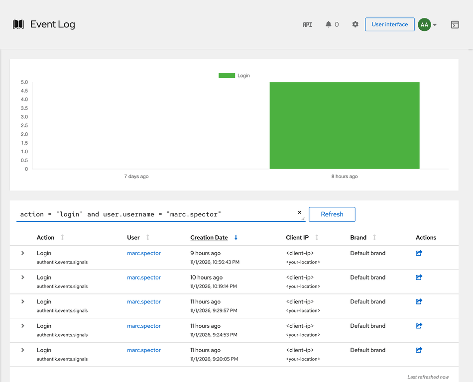
   <em>One person's logins. The newest row is the value for their Last login column. (Source: p. 19, Figure 7.21)</em>

  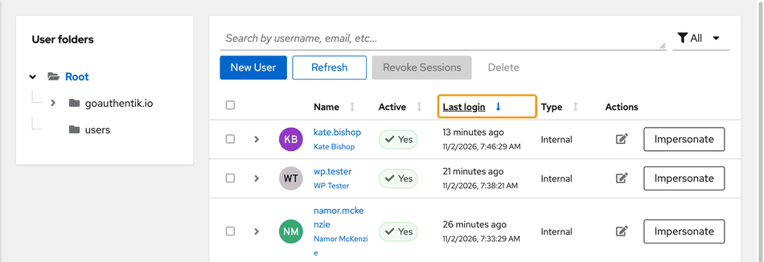 Users with the Last login column" width="85%" />
   <em>The Last login column is a fast cross-check. The event is still your evidence. (Source: p. 19, Figure 7.22)</em>

**Step C: Decide what dormancy means.** A never-used account with application access is a finding and is written down, but it is a **candidate, not an automatic revocation**. Before marking it for revocation, the reviewer checks when it was provisioned: a new joiner who has not logged in yet is new, not dormant. The decision and its reason go into the inventory.

The guide calls the Reason column *the deliverable*. Its contrast: "Revoke: no login in 365 days and no HR record of a start date in that period" is a finding an auditor can test, whereas "Revoke: looks unused" is an opinion.

**Checkpoint 2 (from the guide):** every row has a last-login value or an explicit *never*, and every dormant account carries a written reason. A blank cell means that grant was skipped, not reviewed.

### Section 03: Reconcile against HR and find the orphan

**Goal:** compare identity state against the HR source of truth and find access that outlived its owner's employment.

**Step A: Pull the HR position.** In OrangeHRM, **PIM > Employee List** opens with current employees only. The **Include** filter is set to **Current and Past Employees**, then **Search**. The guide warns that *Employment Status* is a different filter (for values such as Full-Time) and will not bring leavers back. In the source example the count goes from 9 to 11 records, and past employees carry *(Past Employee)* after their last name.

  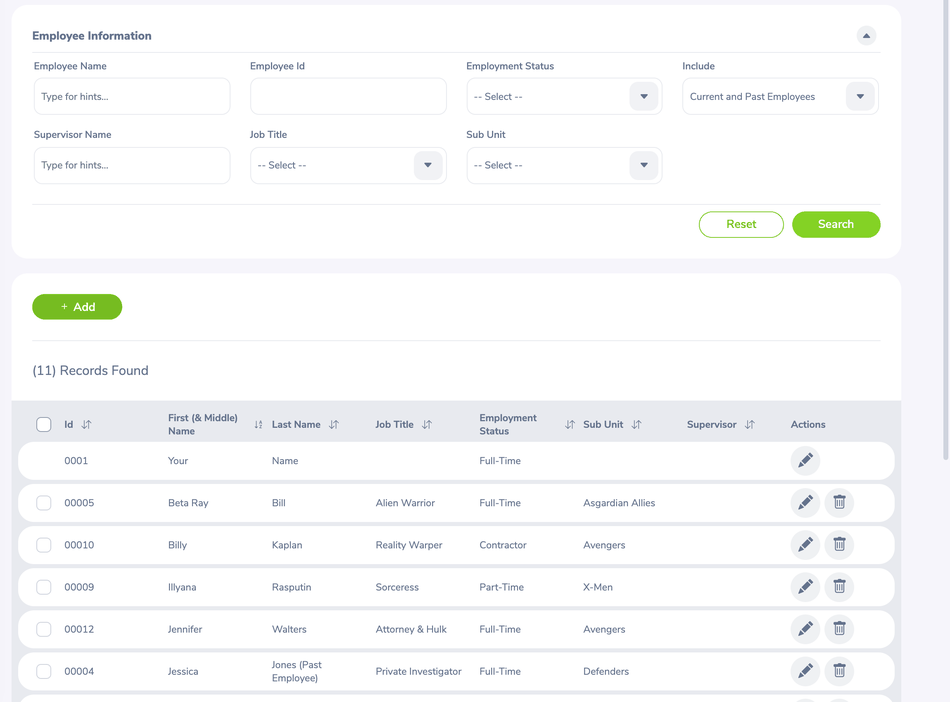
   <em>After Search the count goes from 9 to 11, and past employees carry (Past Employee) after the last name. Jessica Jones is visible here; scroll down on your screen for the rest. (Source: p. 23, Figure 7.28)</em>

<strong>Supporting screenshots (2):</strong> the default employee list and the Include filter

  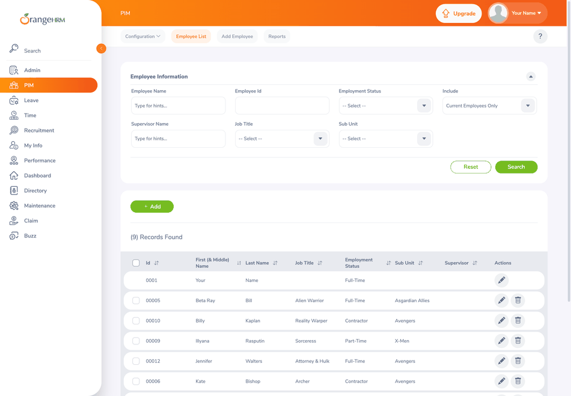
   <em>The default Employee List shows current employees only, 9 records here. Your leaver is not in it. (Source: p. 22, Figure 7.25)</em>

  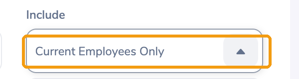
   <em>The Include filter up close. This one setting decides whether leavers show up. (Source: p. 22, Figure 7.27)</em>

**Step B: Reconcile the whole directory.** HR status is filled in for every inventory row. The view is then widened to **every account in Directory > Users, including accounts that belong to no group**, because group-based inventory rows cannot see them. The users list has no group column, so the reviewer compares it against the group member lists from Section 01 or checks each user's **Groups** tab. Those accounts get the same HR status and active columns.

The guide looks for three mismatch types:

| Mismatch | Classification in this review | Why it matters |
|---|---|---|
| Active Authentik account, HR record terminated | **Orphan** account | Belonged to a real person who has left, so it has no valid owner |
| Authentik account with no HR record | **Account requiring ownership/provisioning investigation** | Confirm whether the account has a legitimate purpose, named owner and authorized provisioning history before classifying it as rogue |
| Employed person with no account | **Missing** account | An employee who cannot work |

The guide defines a **rogue** account as one created outside the provisioning process, so that nothing in HR explains it. That definition describes the category; a missing HR record on its own is not enough evidence to place a particular account in it. An account is classified as rogue only after the investigation above finds no legitimate purpose, named owner or authorized provisioning history.

Two points from the guide govern how these are recorded:

- **`akadmin` is not rogue.** It falls in the "no HR record" bucket by design. It is recorded as an administrator account with a **named owner**; a named owner for every account HR does not know about is what an auditor asks for.
- **The Lab 1 leaver is an orphan.** Lab 6's Ticket 2 reactivated the account. In the source example this is `martin.li`: active, in **no groups**, with no WordPress access, but still able to pass Grafana's access check because Grafana has no binding. Their only inventory row is Grafana's "all active accounts" line, which is easy to read past, so they are found in the widened directory list.

  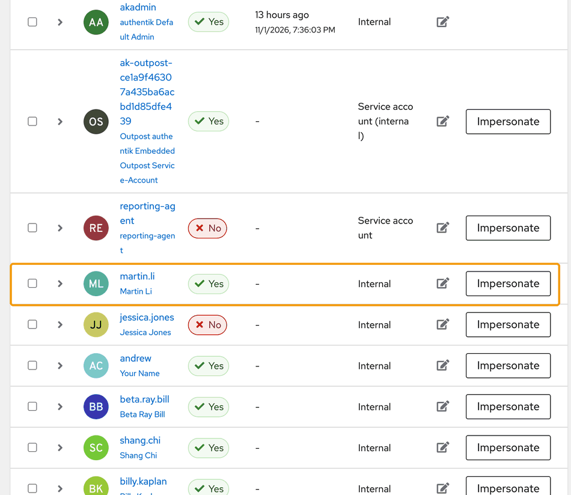
   <em>Your Lab 1 leaver is active again, because Lab 6's Ticket 2 turned the account back on. Here that is martin.li; yours may be named differently. (Source: p. 24, Figure 7.29)</em>

  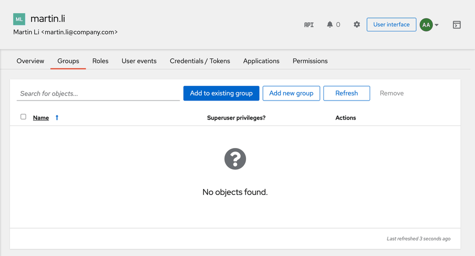
   <em>No groups at all. A group-based review never sees this person, and Grafana still lets them in. (Source: p. 25, Figure 7.30)</em>

The guide's point is that **having no group memberships is not a control**. It means the only access comes from an application nobody gated, and access can be added to a live account in seconds. This is why mature programs reconcile the directory against HR as well as the entitlements, and why NIST SP 800-53 places account review and the link between account management and terminations in one control, **AC-2**.

**Step C: Rank the findings.** Findings are ranked by what an attacker would want, weighing **account state, employment status, application access and privilege**. The guide illustrates the ranking with general examples; these are illustrations of the method, not findings shown in the source environment:

| Ranking example from the guide (hypothetical) | Relative risk |
|---|---|
| Terminated employee with an active Admin grant | Top finding |
| Terminated employee with an active account and no access yet | Second: the same owner problem, one group membership away from the first |
| Dormant Viewer account | Real but minor |

The top finding is then written as one sentence naming the account, the access and the evidence. The source does not show the Lab 1 leaver holding an Admin role, and this documentation does not claim it.

**Checkpoint 3 (from the guide):** HR status is complete, at least one orphan is identified, and findings are ranked rather than listed. If no mismatch appears, the guide's checks, in order, are: confirm Lab 6 was completed; confirm the review widened beyond group-based rows; confirm the OrangeHRM view includes past employees.

### Section 04: Read the audit trail

**Goal:** establish provenance for the findings and check for privileged activity worth questioning.

**Step A: Trace a grant back to its origin.** The filter `action in ("model_created", "model_updated")` lists object creation and changes. The reviewer expands the event for one group and records **who** made the change and **when**: that is the provenance.

  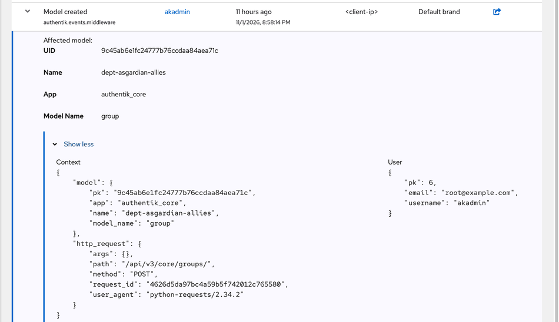
   <em>The expanded event shows akadmin, the group, and a user agent of python-requests, which is how the Lab 1 dashboard's API calls look. A person at a browser shows a browser. On the open source version a change event shows that the group changed, not which member was added. (Source: p. 29, Figure 7.33)</em>

<strong>Supporting screenshot:</strong> group creation events

  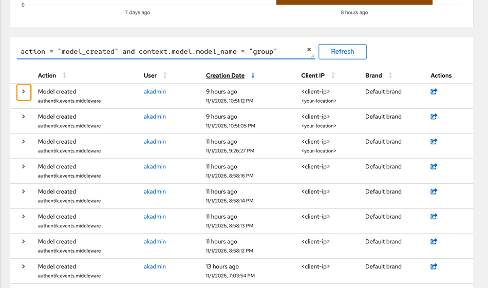
   <em>Filter to model_created events on groups, then click the arrow at the left of a row to expand it. These rows were made by akadmin. (Source: p. 29, Figure 7.32)</em>

The guide is explicit about what this evidence can and cannot show:

- On the open-source version, a `model_updated` event on a group shows that the group changed, **not which member was added**.
- To tie a member to a date, the reviewer matches the time to the Lab 1 dashboard run or the Lab 6 ticket, and states in the finding that it was **matched by time**. That is correlation, not direct proof.
- **`akadmin` is not necessarily a specific person.** The Lab 1 dashboard's API token belongs to `akadmin`, so groups it created show `akadmin` in the user column.
- A **`python-requests`** user agent is consistent with the dashboard's API calls, while a person at a browser shows a browser. This is contextual evidence only.
- If a group is older than the retention window, there is no event at all, and the reviewer records which case applies.

**Step B: Check for privileged activity.** The guide reviews four action types:

| Event | What the reviewer records |
|---|---|
| `impersonation_started` / `impersonation_ended` | Who impersonated whom (`on_behalf_of`) and the reason typed, then whether a ticket backs it |
| `secret_view` | Who viewed a token or certificate, and when |
| `password_set` | The account whose password changed, matched to a Lab 6 ticket |

  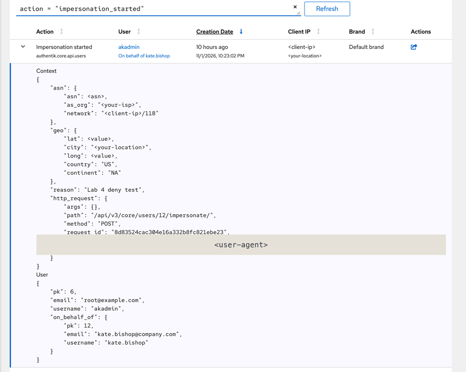
   <em>An expanded impersonation_started event. The reason the admin typed is recorded, here Lab 4 deny test, and the account impersonated shows as on_behalf_of. Read the reason and ask whether a ticket backs it. The user agent line is hidden. (Source: p. 32, Figure 7.35)</em>

  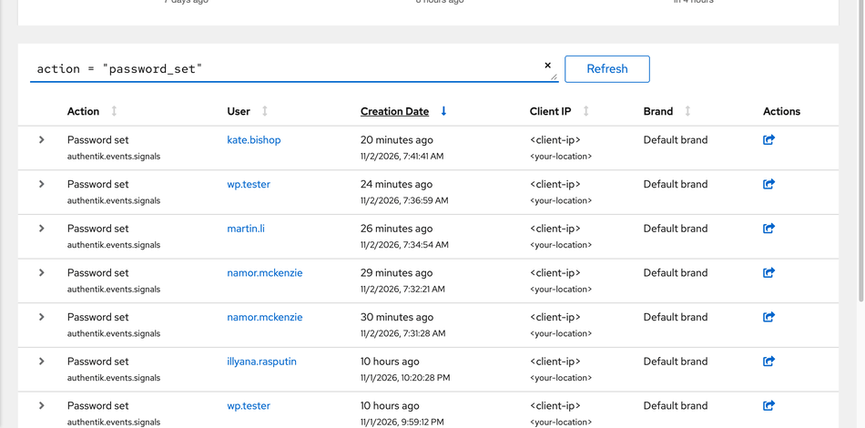
   <em>Password events from Lab 6. The user column is the account whose password changed, so match each one to a ticket. (Source: p. 34, Figure 7.38)</em>

<strong>Supporting screenshots (3):</strong> impersonation events, certificate download and secret_view events

  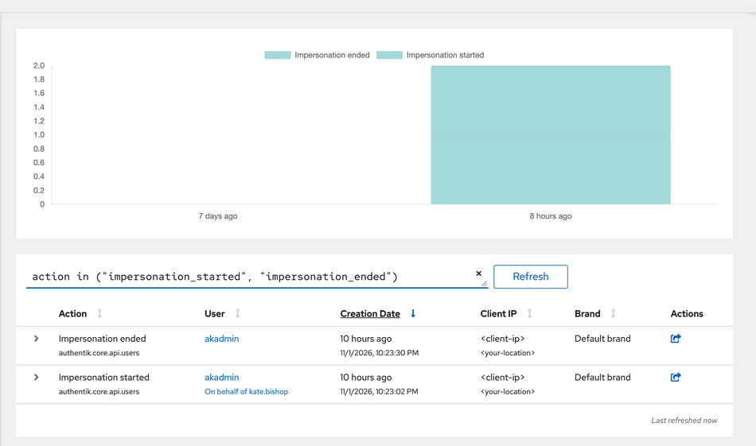
   <em>Impersonation events: one started and one ended, both by akadmin. If yours is empty, that is a clean result. (Source: p. 31, Figure 7.34)</em>
   Clarification: an empty list means no matching events were observed within the available evidence window.

  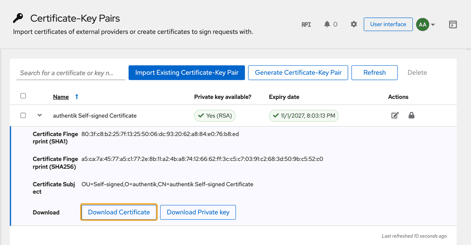 Certificates with the self-signed certificate expanded and public fingerprints shown" width="85%" />
   <em>Under System > Certificates, expand authentik Self-signed Certificate. Download Certificate is the button that logs a secret view. (Source: p. 33, Figure 7.36)</em>

  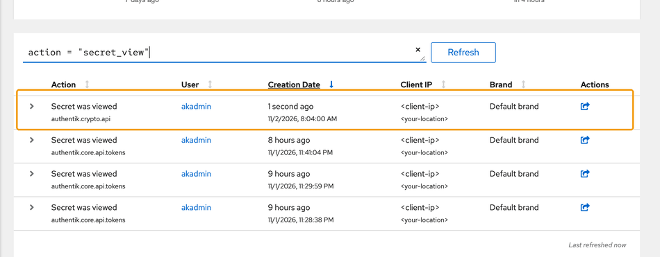
   <em>Your own secret_view for the certificate sits at the top. Other rows on this walk box are token views from later labs, so your list may be shorter. (Source: p. 33, Figure 7.37)</em>

Points from the guide that limit what these events prove:

- On `password_set`, the user is **the account whose password changed, not the person who changed it**. The events around the same second show who was acting. A reset with no ticket behind it is a question worth asking.
- `secret_view` is logged **only for tokens and certificates**. The Grafana client secret copied in Lab 5 never appears, which the guide suggests recording as a gap.
- An empty impersonation or `secret_view` result is recorded as: no matching events were observed within the available evidence window. It is not proof that the action never happened, because events older than the retention window are gone.
- Impersonation, secret views and unexplained password resets are where a compromised administrator or an insider would leave traces, but **none of them proves anything on its own**. Administrators legitimately do all three; what makes them reviewable is that each should have a reason and a request behind it.

**Step C: Note what the log cannot tell you.** The reviewer writes down at least one question the evidence could not answer. The guide's examples:

- Was the grant approved by the person's manager?
- Did a password reset follow a verified identity check?
- Which member did a group change add? The open-source event log does not record it.

The guide stresses that naming the gap is part of the review, not a failure, and is usually the basis of the recommendation that follows.

**Checkpoint 4 (from the guide):** the reviewer can name when and by whom at least one group was created or changed, has checked all four privileged action types, and has written down one unanswerable question.

### Section 05: Produce the evidence package (optional)

**Goal:** export the review as data rather than as screenshots, so it can be repeated and checked.

The guide uses the **existing authenticated Authentik admin session** in the browser (logged in as `akadmin`): Authentik's API uses that login, so no token or extra tooling is needed. `YOUR_AUTHENTIK_URL` is the `http://address:port` part of the lab link, with **no trailing slash**. The guide advises typing the links rather than pasting them from the PDF, because a pasted link can pick up a line break after the `?` and lose the flag.

| Export | Path (appended to `YOUR_AUTHENTIK_URL`) | Saved as |
|---|---|---|
| Users | `/api/v3/core/users/?page_size=100` | `users.json` |
| Groups | `/api/v3/core/groups/?page_size=100` | `groups.json` |
| Applications | `/api/v3/core/applications/?page_size=100&superuser_full_list=true` | `applications.json` |
| Events | `/api/v3/events/events/?page_size=100` | `events.json`, then `events-2.json` and so on |
| Bindings (optional) | `/api/v3/policies/bindings/?page_size=100` | `bindings.json` |

**The applications flag is required.** Without `superuser_full_list=true`, the endpoint returns only the applications the admin account itself may reach. WordPress is gated on a group the admin is probably not in, so it is silently dropped. In the source example both queries report a count of 2, but the plain query returns only Grafana. The guide's rule: **count the records, never the count field**.

  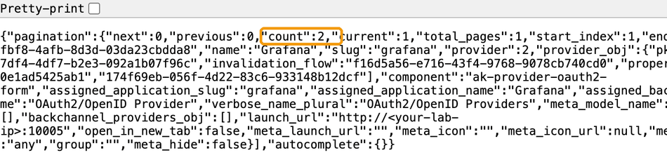
   <em>Without the flag: the count says 2, but only Grafana comes back. WordPress is missing and nothing warns you. (Source: p. 36, Figure 7.41)</em>

  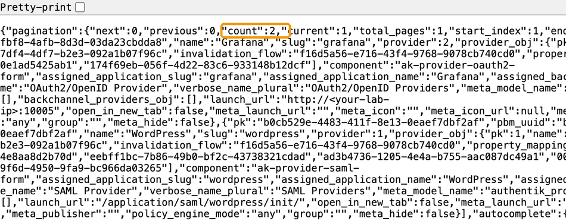
   <em>With superuser_full_list=true: two records, Grafana and WordPress, for a count of 2. Count the records, never the count. (Source: p. 36, Figure 7.42)</em>

**Fetch every page.** Authentik returns at most 100 records per page, newest first. When `total_pages` is more than 1, the same link is opened with `&page=2` and so on until the last page. In the guide, the bindings export is how the reviewer proves Grafana has no bindings: its row is missing from the file. Examples of the pagination blocks are under [Screenshots & Evidence](#screenshots-evidence).

The four export files plus the completed inventory table form the guide's evidence package. **These are outputs the lab asks the reviewer to produce. They are not included in this documentation, and none have been generated or fabricated here.**

**Checkpoint 5 (from the guide):** the applications export contains every application inventoried in Section 01, checked record by record, and the records across all event pages add up to the count.

---

## :mag: Key Findings / Results

### Source-demonstrated observations

These observations are visible in the guide's example screenshots. They describe the guide author's environment and are **examples, not results from the portfolio owner's environment**.

| Observation (source example) | Why it matters for the review | Source evidence |
|---|---|---|
| Grafana has no bindings | Every active account can sign in, so Grafana is "all active accounts" | Figure 7.9 |
| WordPress is bound to `dept-avengers` | WordPress rows are that group's members | Figure 7.10 |
| WordPress assigns one default role, Subscriber, with no per-group mapping | Recorded as a finding: no group-based role differentiation in this plugin configuration; new SSO accounts receive Subscriber by default, and hand-edited roles must be inspected | Figures 7.13 and 7.14 |
| Event retention is `days=365` | A configured limit; the real evidence window starts at the oldest event | Figure 7.20 |
| An account with no login events | A dormant candidate, pending its creation date | Figure 7.23 |
| The Include filter changes the employee count from 9 to 11 | The default view hides leavers | Figures 7.25 and 7.28 |
| The Lab 1 leaver (`martin.li` in the example) is active and in no groups | An orphan that a group-based review misses, still able to reach Grafana | Figures 7.29 and 7.30 |
| Group creation by `akadmin` with a `python-requests` user agent | Consistent with the Lab 1 dashboard's API calls; contextual, not proof of a person | Figure 7.33 |
| One impersonation session by `akadmin`, with the reason "Lab 4 deny test" | The reason is recorded; the reviewer asks whether a ticket backs it | Figures 7.34 and 7.35 |
| The applications export without the flag reports a count of 2 but returns one record | Counting the count field would hide the missing application | Figures 7.41 and 7.42 |

### Expected outputs (not included)

The guide's checklist describes what a completed review contains. These items depend on the reviewer's own environment, and **completion by the portfolio owner has not been verified**:

| Item from the guide's testing checklist | Status in this documentation |
|---|---|
| Inventory with one row per person per application, covering both applications | Method documented; no inventory included |
| Every row records the group that produces the access | Method documented |
| Every row has a last-login value or an explicit *never* | Method documented |
| Retention window established before drawing conclusions from an absence | Method documented |
| HR status filled in for every row, with terminated employees included | Method documented |
| Accounts in no group reconciled as well as group-based rows | Method documented |
| At least one orphan account identified | Shown in the source example only |
| Findings ranked by risk, not merely listed | Method documented; no ranked findings included |
| Every decision has a written reason, including keeps | Method documented; no decisions included |
| Provenance established for at least one grant | Shown in the source example only |
| Impersonation, secret view and password reset events reviewed | Shown in the source example only |
| One unanswerable question written down | Guide examples listed |
| Applications export checked record by record | Shown in the source example only |
| All four exports saved (if Section 05 is done) | Not included |

### Troubleshooting (from the guide)

| Symptom | Likely cause and fix |
|---|---|
| No terminated employees in OrangeHRM | The Include filter starts on Current Employees Only; set it to Current and Past Employees and search again |
| No login events for anyone | Wrong action name, or looking at System Tasks instead of Events; log in as a test user in a private window and confirm the event appears |
| Every account looks dormant | Likely true in a lab with little real usage; judge dormancy against when the account was created, not an absolute date |
| Cannot find who created a group | Dashboard-created groups show `akadmin`; check the user agent (`python-requests` versus a browser). If the group is older than retention, there is no event; record which case applies |
| No `secret_view` events | No matching events were observed within the available evidence window. Separately, `secret_view` covers only tokens and certificates, so the Grafana client secret is never logged; record that as the Step C gap |
| No impersonation events | No matching events were observed within the available evidence window; record the check and that result |
| Export shows 403 or "Authentication credentials were not provided" | Not logged in as `akadmin` in this browser, or the session expired; log in in another tab and reload |
| API returns an empty result set | Check `page_size` and the path; results are wrapped in a `results` array with a pagination block |
| Row count equals the user count | The inventory was built one row per person; split each person's WordPress and Grafana access into separate rows |

---

## :brain: Skills Demonstrated

- Planning a User Access Review: certification, attestation and recertification concepts
- Building a grant-level entitlement inventory across applications with different access models
- Reading application bindings and recognizing an unbound application as open access
- Distinguishing configured role mappings from the effective roles held in each application
- Using log retention to qualify conclusions about dormant accounts
- Reconciling a directory against an HR source of truth, including accounts with no groups
- Distinguishing orphan and missing accounts, investigating ownership and provisioning history before classifying an account as rogue, and ranking findings by risk
- Establishing provenance from an audit trail while stating its limits
- Reviewing privileged activity (impersonation, secret views, password changes) without over-claiming
- Producing verifiable, repeatable evidence through read-only API exports and pagination checks

---

## :camera_with_flash: Screenshots & Evidence

Additional screens from the source guide that support Section 05. Expand each section to view them.

<strong>Export pagination evidence (2):</strong> users and events pagination blocks

  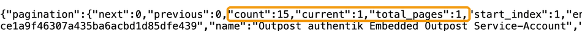
   <em>The users export as raw data. The pagination block at the top tells you how many records there are: count 15 here. (Source: p. 36, Figure 7.39)</em>

  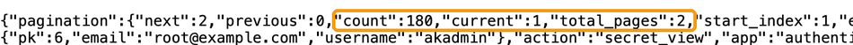
   <em>The events export stops at 100 records a page: count 180 and total_pages 2 here. When total_pages is more than 1, save the next page too. (Source: p. 36, Figure 7.40)</em>

<strong>Troubleshooting evidence:</strong> a logged-out export

  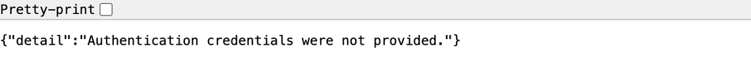
   <em>This is what a logged-out export looks like. Log in to Authentik in another tab, then reload. (Source: p. 40, Figure 7.43)</em>

A full list of screenshots, source pages, figure numbers, exact source captions and sensitivity-review decisions is kept in [`docs/evidence-manifest.json`](docs/evidence-manifest.json).

---

## :briefcase: Real-World Relevance

- **Identity governance:** periodic access reviews are a standard governance control, and the guide's emphasis on *who certified and what they were shown* reflects what auditors test. A grant-level inventory with a reason for every decision is what makes a review defensible.
- **Audit and compliance:** reconciling accounts against HR terminations is the account-management concern that NIST SP 800-53 addresses in control AC-2. Orphaned accounts of former employees are a common audit finding.
- **Security operations:** unbound applications, reactivated leaver accounts and unexplained privileged events are realistic routes to unauthorized access. Knowing what each log entry does and does not prove keeps investigations accurate.
- **Scaling reviews:** the guide notes that a screenshot proves what one screen looked like once, while an export can be compared with next quarter's. Exports turn a one-off exercise into a control that detects change.

---

## :memo: Summary

This lab documents a User Access Review across Authentik, WordPress, Grafana and OrangeHRM. Following the source guide, the review builds an entitlement inventory with one row per person per application, qualifies dormant accounts against the event retention window, reconciles the whole directory against HR to find the orphan account that a group-based review misses, establishes provenance from the audit trail while recording what it cannot prove, and optionally exports the underlying data with a record-by-record check.

The guide’s intended outcome is a review in which every grant carries a decision and a written reason, backed by evidence that another person could verify. The screenshots and examples come from the guide author's environment; a completed inventory, certification decisions and exports from the portfolio owner's own environment are not part of this documentation.

---

## :warning: Disclaimer

This project is documented for educational and portfolio purposes. The lab design, instructions and screenshots are from *Hands-On IAM Labs – Lab 7: Access Review and Audit* (V8) by Andrew, All Things Identity, and remain the property of their author. Names in the screenshots are fictional lab accounts, network details were already replaced with placeholders by the guide author, and no passwords, tokens, private keys or live identity data are included. No lab infrastructure was accessed or changed in preparing this documentation.

---

  <strong>Created as part of a professional cybersecurity and IAM portfolio.</strong>

